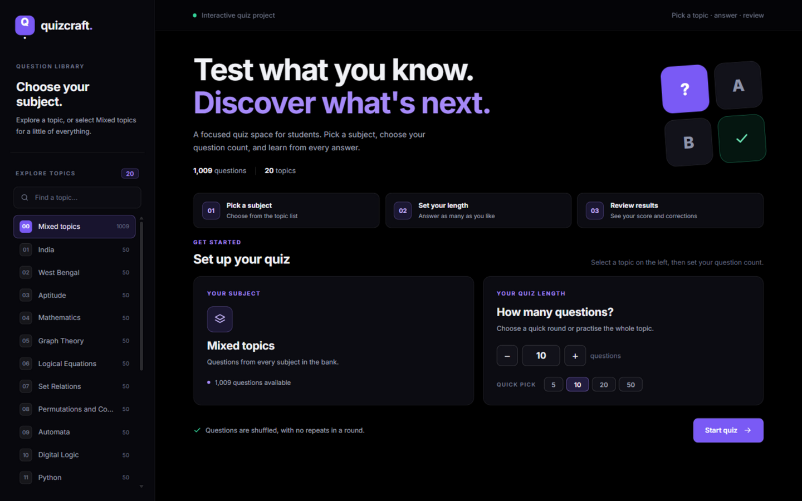

<div align="center">

# 🎯 Quizcraft

**A React quiz app with 1,009 questions across 20 topics — served by a zero-dependency Python API.**

[](LICENSE)
[](https://react.dev)
[](https://vite.dev)
[](https://www.python.org)



*Pick a topic · set your length · answer · review*

</div>

---

## ✨ Features

- 🧠 **1,009 questions** — every topic ships at least 50 MCQs, from DSA and automata to AI agents and general knowledge
- 📚 **20 topics** — academics, programming, and AI covered in depth
- ⚡ **Instant feedback** — correct/incorrect highlight after every answer
- 🔀 **Randomized draws** — no repeats within a round, a fresh mix every time
- 🎛️ **Mixed mode** — quiz across all topics at once
- ⌨️ **Keyboard shortcuts** — `A`–`D` / `1`–`4` to answer, `Enter` to continue
- 🔍 **Topic search** — filter the library as you type
- 📊 **Answer review** — every missed question waiting for you at the end
- 📱 **Responsive** — desktop sidebar or mobile topic chips

## 🚀 Quick Start

**1. Build the client** (first time only — requires [Node.js](https://nodejs.org)):

```powershell
cd client
npm install
npm run build
```

**2. Start the server** (Python 3.8+, standard library only):

```powershell
python server/web_app.py
```

Open **http://127.0.0.1:8000/** and play. Busy port? Add `--port 8080`. Stop with `Ctrl+C`.

### 🧪 Development Mode

Hot-reload while you edit the React app:

```powershell
# Terminal 1 — API server on :8000
python server/web_app.py

# Terminal 2 — Vite dev server on :5173 (proxies /api automatically)
cd client
npm run dev
```

Open **http://localhost:5173/** — changes to `client/src` apply instantly.
If port 8000 is taken: `python server/web_app.py --port 8080`, then `API_PORT=8080 npm run dev`.

> 🕹️ Prefer the terminal? The original CLI game still runs: `python server/quiz_game.py`

## 🕹️ How to Play

1. **Pick a subject** from the sidebar, or keep **Mixed topics** for a bit of everything
2. **Set your length** — a quick 5-question round or the whole topic
3. **Answer** by clicking, or press `A`–`D` / `1`–`4`
4. **Review** your score, percentage, and every question you missed — then go again

| Score | Verdict |
| :---: | :--- |
| 90 – 100% | Excellent work! |
| 70 – 89% | Good job! |
| 0 – 69% | Keep practicing! |

## 🧱 Tech Stack

| Layer | Tech | Notes |
| --- | --- | --- |
| Frontend | React 18 + Vite | Component screens, `useQuiz` state hook, zero UI libraries |
| Backend | Python stdlib | `http.server`-based API — no pip installs |
| Data | `question_bank.py` | 1,009 curated tuples, validated on load |

## 📚 Topics

<details>
<summary><strong>View all 20 topics</strong> (click to expand)</summary>

| # | Topic | Questions | # | Topic | Questions |
| --- | --- | --- | --- | --- | --- |
| 1 | India | 50 | 11 | Python | 50 |
| 2 | West Bengal | 50 | 12 | Web Design | 50 |
| 3 | Aptitude | 50 | 13 | DSA | 50 |
| 4 | Mathematics | 50 | 14 | Java | 50 |
| 5 | Graph Theory | 50 | 15 | PHP | 50 |
| 6 | Logical Equations | 50 | 16 | C Programming | 50 |
| 7 | Set Relations | 50 | 17 | JavaScript | 50 |
| 8 | Permutations and Combinations | 50 | 18 | AI Applications | 59 |
| 9 | Automata | 50 | 19 | AI Agents | 50 |
| 10 | Digital Logic | 50 | 20 | General Knowledge | 50 |

Topic counts are generated from the data, so they stay accurate as the bank grows.

**Depth notes:** Graph Theory (MST, flow, matching) · Logical Equations (truth tables, quantifiers) · Set Relations (cardinality, pigeonhole) · Permutations & Combinations (nCr/nPr, derangements) · Automata (DFA/NFA/PDA/Turing, pumping lemma) · Digital Logic (K-map, flip-flops) · DSA (trees, hashing, DP) · AI Applications (NLP, vision, recommenders) · AI Agents (PEAS, ReAct, multi-agent collaboration)

</details>

## 🛠️ Adding Questions

Append a tuple to any topic in [`server/question_bank.py`](server/question_bank.py):

```python
("What is the question?", ("Option A", "Option B", "Option C", "Option D"), 2),
```

The loader enforces:

- Exactly **4 options**, all distinct and non-empty
- `correct_index` is **zero-based** — `0` for A through `3` for D
- Question text is **unique** across the whole bank

Everything else — topic counts, menus, percentages — updates automatically. Just refresh the page.

## 🗂️ Project Layout

```
QuizGame/
├── client/                     # React 18 + Vite app
│   ├── index.html
│   ├── vite.config.js          # /api proxied to Python in dev
│   └── src/
│       ├── App.jsx             # shell + screen switching
│       ├── components/
│       │   ├── Sidebar.jsx     # topic library + search
│       │   ├── Topbar.jsx
│       │   ├── screens/        # Setup · Quiz · Results
│       │   └── ui/             # SVG icons, score ring
│       ├── hooks/
│       │   └── useQuiz.js      # quiz state machine
│       ├── lib/api.js
│       └── styles/index.css
├── server/                     # Python (standard library only)
│   ├── web_app.py              # serves client/dist + /api/questions
│   ├── quiz_game.py            # terminal game + question loader
│   └── question_bank.py        # 1,009 questions by topic
├── docs/screenshot.png
└── LICENSE
```

## 📄 License

Released under the [MIT License](LICENSE) — free to use, modify, and distribute.

<div align="center">

**⭐ Star this repo if it helped you study!**

</div>
